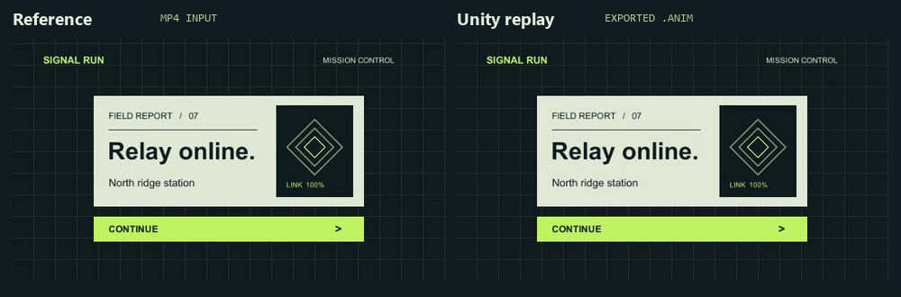

# Unity Motion Match

**Unity 메뉴를 2초간 녹화하면, 기존 버튼과 패널에 적용할 수 있는 `.anim` 클립을 만듭니다.** 레퍼런스가 바뀌면 같은 작업 폴더에서 MP4만 교체하고 다시 실행할 수 있습니다. 위치·크기·불투명도를 맞춘 뒤 Unity Play Mode에서 버튼 연결과 레이아웃 복원을 검사합니다.

[English](README.md) · [베타 다운로드](https://github.com/king-beomsoo/unity-motion-match/releases)



이 메뉴와 원본 영상이 저장소에 들어 있습니다. [예제 프로젝트](examples/signal-run) · [원본 MP4](examples/signal-run-reference.mp4)

## Codex에서 사용하기

Node.js가 설치된 환경에서 Codex를 사용하는 프로젝트 폴더를 열고 실행합니다.

```sh
npx skills add king-beomsoo/unity-motion-match --skill unity-motion-match -a codex
```

> $unity-motion-match로 C:/Games/Relay의 결과 패널과 계속 버튼을 C:/Refs/debrief.mp4에 맞춰줘. 프로젝트 복사본에서 작업하고 클립과 버튼 연결 검사 결과를 보여줘.

## 같은 데모 실행하기

Windows와 Unity 6000.3.21f1에서 검증했습니다. 데모는 Unity Hub 기본 경로에서 이 버전을 선택합니다. 다른 위치에 설치했다면 마지막 명령에 `--editor "C:/경로/Unity.exe"`를 추가하세요. Unity 6000.6.3f1에서는 참조 검사 API의 변경으로 브리지가 컴파일되지 않습니다. Python을 설치하고 터미널에서 `ffmpeg` 명령을 실행할 수 있게 준비합니다.

```powershell
git clone https://github.com/king-beomsoo/unity-motion-match.git
cd unity-motion-match
python -m pip install -r requirements.txt
python examples/run_demo.py ../signal-run-work
```

작업 폴더는 비어 있어야 합니다. 완료되면 작업 폴더의 `selection.html`에서 선택된 오브젝트를, `unity/Assets/MotionMatchGenerated/`에서 두 클립을, `evidence/r1/`에서 재생 프레임과 검사 결과를 볼 수 있습니다.

Unity 없이도 저장소에 담긴 두 Play Mode 캡처를 Python 표준 라이브러리로 비교할 수 있습니다.

```sh
python benchmarks/score.py benchmarks/evidence/signal-run-truth.json benchmarks/evidence/signal-run-replay.json --require-peak --out score.json
```

## 검증 범위

Signal Run 데모의 최대 불투명도 오차는 **0.01426**이었습니다. 별도 게임 메뉴에서 같은 이름의 61프레임 MP4를 60프레임 MP4로 교체했을 때 오차는 각각 **0.02396**, **0.02240**이었습니다. 같은 메뉴의 추가 모션에서는 하단 안내의 3개 프레임이 기준 0.035를 넘었고 최댓값은 **0.10335**였습니다. 세 실행 모두 버튼 7개의 연결을 유지했고, 두 해상도에서 복원한 레이아웃의 차이는 0이었습니다.

베타는 고정된 카메라로 녹화한 동일한 화면의 **screen-space uGUI**를 대상으로 합니다. 녹화는 원래 자세에서 끝나야 합니다. [내 프로젝트에 적용하기](SKILL.md) · [검증 결과](references/validation.md) · [문제 보고](https://github.com/king-beomsoo/unity-motion-match/issues/new) · [MIT 라이선스](LICENSE)
