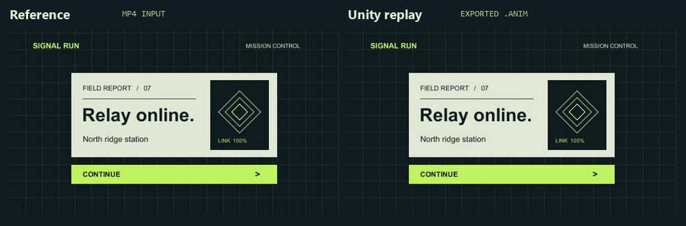

# Unity Motion Match

**Turn a two-second recording of your Unity menu into editable animation clips on the buttons and panels you already have.** When the reference changes, replace the MP4 and refit the motion in the same project copy. The skill matches position, scale and opacity, then checks the UI in Unity Play Mode.

[한국어](README.ko.md) · [Download the beta](https://github.com/king-beomsoo/unity-motion-match/releases) · [Supported UI and limits](references/automatic-binding.md)



Both sides come from the included **Signal Run** scene. The left is the decoded MP4. The right is a fresh Unity capture playing the two fitted clips. The card and Continue button finished at their original positions. [Reference MP4](examples/signal-run-reference.mp4) · [Example Unity project](examples/signal-run)

## Install the skill

With Node.js and the skills CLI, run this from the project where you use Codex:

```sh
npx skills add king-beomsoo/unity-motion-match --skill unity-motion-match -a codex
```

Then give the agent a project, a recording and the objects you want to move. For example:

> Use $unity-motion-match on my Unity project at C:/Games/Relay. Match C:/Refs/debrief.mp4 to the results panel and Continue button. Work in a copy, export the clips and show me the button and layout checks.

## Run the demo

Tested on **Windows with Unity 6000.3.21f1**. The demo selects that editor from the standard Unity Hub location. Install Python and make `ffmpeg` available on PATH for MP4 input. From PowerShell:

```powershell
git clone https://github.com/king-beomsoo/unity-motion-match.git
cd unity-motion-match
python -m pip install -r requirements.txt
python examples/run_demo.py ../signal-run-work
```

Use an empty workspace. To select a specific Unity installation, add `--editor "C:/path/to/Unity.exe"` to the last command. Open `../signal-run-work/selection.html` for the selected objects. Find the two exported `.anim` files in `../signal-run-work/unity/Assets/MotionMatchGenerated/` and the replay frames and checks in `../signal-run-work/evidence/r1/`.

**Try the accuracy check without Unity.** From the cloned repository, compare the original and fitted Play Mode samples using only Python’s standard library:

```sh
python benchmarks/score.py benchmarks/evidence/signal-run-truth.json benchmarks/evidence/signal-run-replay.json --require-peak --out score.json
```

The command prints `"passed": true` for the bundled pair. Open `score.json` for the worst frame, position and opacity errors, and the preservation checks.

## Use your own menu

1. Prepare a copy with `python scripts/unity.py prepare --source C:/MyGame --workspace C:/motion-work --editor "C:/Program Files/Unity/Hub/Editor/6000.3.21f1/Editor/Unity.exe"`. Open `selection.html` to review the selected UI and read the case ID from `workspace.json`.
2. Save a recording of the **same UI** to `C:/refs/CASE_ID-r1/reference.mp4`. Use a fixed camera, two seconds at 30 fps, and end at the menu’s rest pose.
3. Run `python scripts/unity.py match --workspace C:/motion-work --reference C:/refs --revision r1`. Replacing the file and rerunning refits the same revision. Use a new revision to keep both sets of clips.

For a particular scene or group, use the scene path and target selectors in the [skill instructions](SKILL.md). The beta targets screen-space uGUI. UI Toolkit, world-space canvases and arbitrary rotations are outside its current scope. Unity 6000.6.3f1 currently rejects a serialized-reference API used by the bridge.

## What passed in Unity

Maximum absolute opacity error is measured on a 0–1 scale. The per-frame target was **0.035**.

| Recording | Worst opacity error | Result |
| --- | ---: | --- |
| Signal Run demo, 60-frame MP4 | 0.01426 | Passed |
| Existing game menu, 61-frame MP4 | 0.02396 | Passed |
| Different 60-frame MP4 at the same path | 0.02240 | Passed |
| Additional motion in the same game menu | 0.10335 | Exceeded the target on 3 navigation-panel frames |

All three game-menu runs preserved seven button raycast targets, serialized listeners and object references. Layout restoration had zero measured difference at 960×540 and 768×648. These checks cover bindings and layout. Game-specific actions such as purchasing need a gameplay test. [Validation details](references/validation.md) · [Method and papers](references/method-and-evidence.md)

If a recording drifts, report the Unity version, canvas type, and the first timestamp where the replay diverges. [Open an issue](https://github.com/king-beomsoo/unity-motion-match/issues/new)

Released under the [MIT License](LICENSE).
